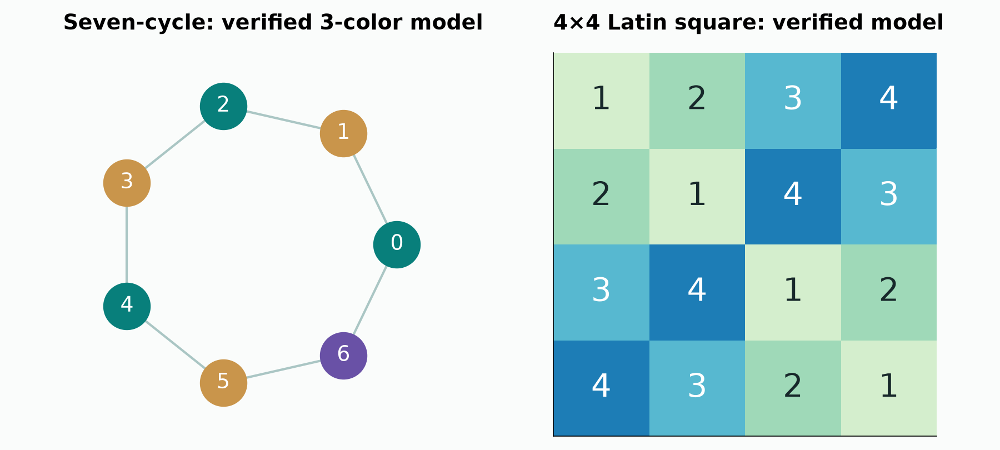

# Java CNF solver lab

**[View the report in your browser](https://Michaelhoang8.github.io/java-cnf-solver-lab/)**

A Java 21 DPLL SAT solver with two-watched-literal propagation, a reversible assignment trail, strict DIMACS parsing and explicit `SAT` / `UNSAT` / `UNKNOWN` outcomes. A full-scanner propagation mode shares the search engine for comparison.



This is an AI-assisted portfolio study using generated synthetic constraints. Java performs all solves. Python generates fixtures, independently verifies assignments and plots recorded counters and timings. No external Java runtime dependencies are required.

## Inspect the artifacts

- [Static report](docs/report.html), [measured findings](results/findings.md), [summary CSV](results/summary.csv).
- [Ten DIMACS fixtures](inputs/) with [expected-status evidence](inputs/manifest.json).
- [Raw solve records, signed assignments, search traces and per-clause model witnesses](results/raw/).
- [DPLL implementation](src/lab/Solver.java), [strict parser](src/lab/Dimacs.java), [independent brute-force tests](src/lab/SolverTests.java) and [additional review tests](src/lab/SolverReviewTests.java).
- [Algorithm](docs/algorithm.md), [input/output format](docs/format.md), [measurement protocol and limits](docs/measurement.md).
- [Screenshots](docs/screenshots/README.md) and [continuous report review](docs/recordings/README.md).

## Reproduce

Use JDK 21 with `java` and `javac` on PATH, plus Python 3.13 for fixture generation and plotting.

```sh
python -m pip install -r requirements.txt
python scripts/run_study.py --output-dir build/my-run
python scripts/verify_results.py --output-dir build/my-run
```

The driver compiles all Java sources, runs both test suites, regenerates fixtures, executes one untimed solve and three measured solves per fixture/mode, verifies every original clause of each SAT model, and generates `build/my-run/docs/report.html`. `--quick` uses one measured solve per configuration. Subprocess timeouts bound a failed reproduction. The committed full run contains 60 measured solves.

Solve a single file using the classes created by the driver:

```sh
java -cp build/my-run/build/classes lab.Solve inputs/latin-square4.cnf 100000 WATCHED
java -cp build/my-run/build/classes lab.Solve inputs/pigeonhole5-into4.cnf 100000 SCANNER
java -cp build/my-run/build/classes lab.Solve inputs/budget-exhaustion.cnf 0 WATCHED
```

The last command prints `s UNKNOWN`; a zero budget does not prove unsatisfiability. Propagation alone can still establish SAT or UNSAT without spending decisions.

To replace the committed measurements, omit `--output-dir`. `--reuse` only regenerates plots and findings when Java and fixture-generator source hashes match the recorded run. CI validates committed evidence and runs a fresh quick study in a separate directory.

## Correctness evidence

Seven Java test groups include 1,800 seeded formulas with up to eight variables, independently enumerated against both propagation modes: 3,600 differential solve comparisons. Targeted tests cover exact branch-budget boundaries, positive-branch conflict followed by successful negative branching, watch movement after rollback, empty clauses, contradictory units, tautologies, duplicate literals and malformed input. SAT models are checked against original clauses, including those removed by normalization.

UNSAT examples have independent analytical explanations: four-clique three-coloring and pigeonhole encodings. Small random formulas also use exhaustive enumeration. Search traces are diagnostic records, **not UNSAT proof certificates**.

## What the comparison shows

Watched propagation avoids repeatedly scanning unrelated clauses. The forward/reverse implication-chain pair deliberately demonstrates sensitivity to clause order. Fewer literal checks do not guarantee a faster small solve: watch-list operations, instrumentation, JIT compilation and other work remain. The report preserves actual timings, including cases where scanning is faster.

This is DPLL, with no clause learning, restarts, CDCL, incremental solving, assumptions API or DRAT/LRAT proof generation. Bounds are 256 variables, 5,000 original clauses, 50,000 original literals and at most one million branch assignments. Decision budgets are work limits, not hard wall-clock deadlines; exhausting one returns UNKNOWN.

## Presentation revisions

The responsive report update reuses the recorded measurements. The exact original measured driver is preserved in [results/measurement-sources/run_study.py](results/measurement-sources/run_study.py), with its original LF-normalized SHA256 in the adjacent manifest. The current `results/source-sha256.json` records unchanged measured implementation sources plus the current presentation/verification driver. It does not claim that revised report styling was present during the original measurements.

`python scripts/run_study.py --reuse` checks the measured implementation before regenerating the report from recorded results. No timing samples are collected in that mode. `python scripts/verify_results.py` checks the archived driver hash as well as the measured evidence.
